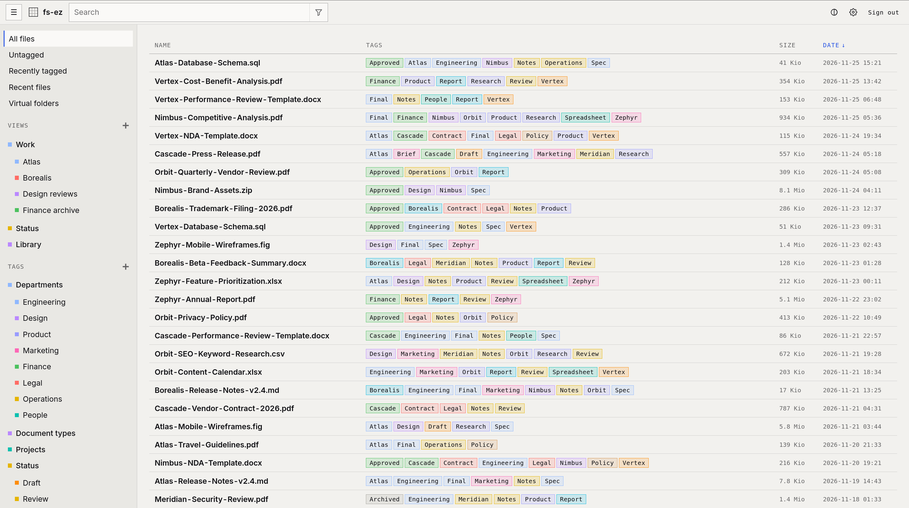

<p align="center">
  
</p>

<h1 align="center">fs-ez</h1>

<p align="center">
  A self-hosted file library packaged into a single static Rust binary, backed by SQLite.
</p>

<p align="center">
  <a href="LICENSE"></a>
  
  <a href="https://ghcr.io/fs-ez/fs-ez"></a>
  
</p>

<p align="center">
  
</p>

## Quick start

```yaml
# docker/compose.yml
services:
  fs-ez:
    image: ghcr.io/fs-ez/fs-ez:latest
    container_name: fs-ez
    environment:
      TZ: Etc/UTC
      PUID: "1000"
      PGID: "1000"
    volumes:
      - ./config:/config # SQLite database + backups
      - ./data:/data     # managed files + inbox
    ports:
      - 8678:8678 # Web UI, API and WebDAV
    restart: unless-stopped
```

Open <http://localhost:8678> and create the user on `/setup`.

## Docs

- [Setup & rescue](docs/setup.md) — volumes, environment, backups, CLI recovery
- [API](docs/api.md) — Bearer tokens, REST routes, WebDAV
- [Development](docs/development.md) — gates, dev server, audit, layout

## License

MIT — see [LICENSE](LICENSE).
